<!-- mcp-name: io.github.slowave-ai/slowave -->

---

<p align="center">
  <b>English</b> | <a href="README.zh-CN.md">中文</a>
</p>

<p align="center">
  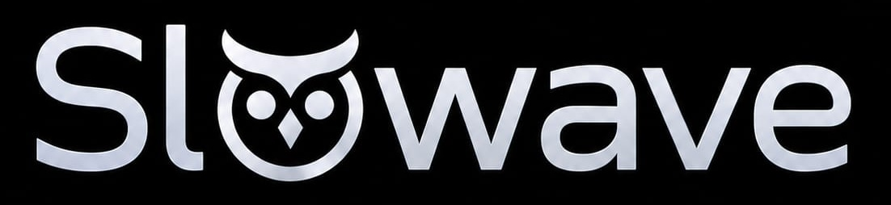
</p>
<p align="center">
  <b>Living memory layer across your coding agents and AI tools.</b>
</p>
<p align="center">
  <a href="https://pypi.org/project/slowave/"></a>
  
  
  
</p>

<p align="center">
  <strong>Supported clients:</strong>
</p>

<p align="center">
  &nbsp;&nbsp;
  <picture><source media="(prefers-color-scheme: dark)" srcset="img/clients/copilot-dark.svg" /></picture>&nbsp;&nbsp;
  <picture><source media="(prefers-color-scheme: dark)" srcset="img/clients/openai-dark.svg" /></picture>&nbsp;&nbsp;
  &nbsp;&nbsp;
  &nbsp;&nbsp;
  &nbsp;&nbsp;
  <picture><source media="(prefers-color-scheme: dark)" srcset="img/clients/cline-dark.svg" /></picture>&nbsp;&nbsp;
  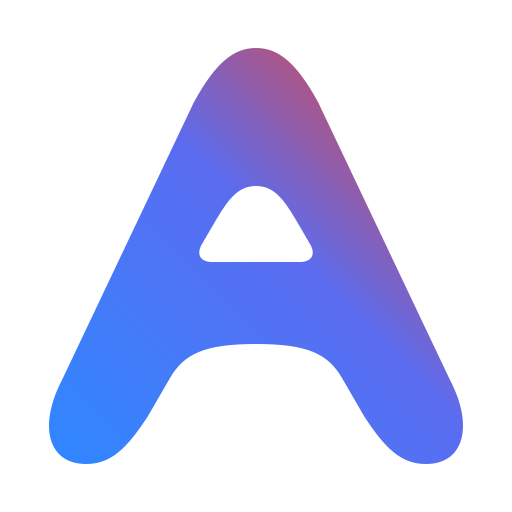&nbsp;&nbsp;
  
</p>

Slowave is a local MCP memory server that carries your decisions, constraints, and procedures across your coding sessions and AI tools.

Slowave adapts as you use it, building reusable context over time so your agent can learn from past experience.

It runs on your machine and requires no LLM API key for memory maintenance. 

The local dashboard lets you inspect your memories and how they support your agent in your day to day work.

---


https://github.com/user-attachments/assets/2d4eeb4e-419f-46fa-b23e-cf501a715d1e


---

At the core Slowave is built around a simple concept:

> **Reasoning and memory feed each other in a continuous loop.**

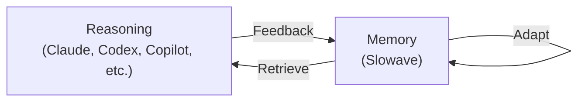

Slowave retains what helps agents achieve their goals, weakens what does not, and continuously adapts based on use. It does this through a continuous feedback loop between your agent and its memory. It works on 5 simple MCP endpoints:

> **activate → remember → recall → feedback → commit**


Memory is continuously reshaped by use rather than a static collection of facts waiting to be retrieved:

- Keep context across tasks
- Evolves through feedback
- Learns from experience
- Runs locally
- No LLM API key
- Inspectable and measurable

The first useful payoff is simply not having to repeat the same constraint in the next task. 

Over time, the way you work becomes reusable context for your agent.


<p align="center">
  <sub><a href="#supported-clients">Platform coverage and setup details</a></sub>
</p>

## Installation

To install and configure all clients in one go:

```bash
pipx install slowave
slowave setup
```

To configure just one client at a time, see the [installation reference](docs/install.md).

> [!IMPORTANT]
> **No LLM API key required.**

### Upgrading Slowave

When upgrading to a new version:

```bash
slowave stop
pipx upgrade slowave
slowave setup
slowave dashboard
```

## Workflow

You keep working with your agent as usual. 

You can switch agents or start new sessions. 

Slowave enriches your agents context with relevant memories and procedures. Your agent feedbacks Slowave on what was useful. Slowave keeps building relevant context for your agents in the background.


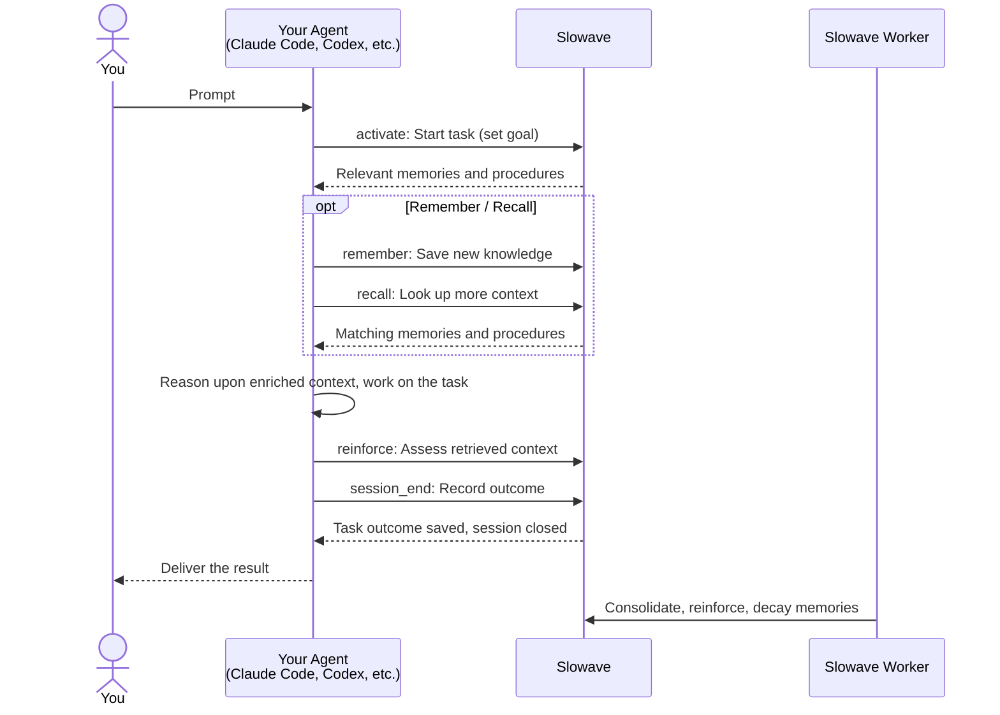


## Dashboard

Start the dashboard with:

```bash
slowave dashboard
```

<p align="center">
    <a href="img/overview.jpg">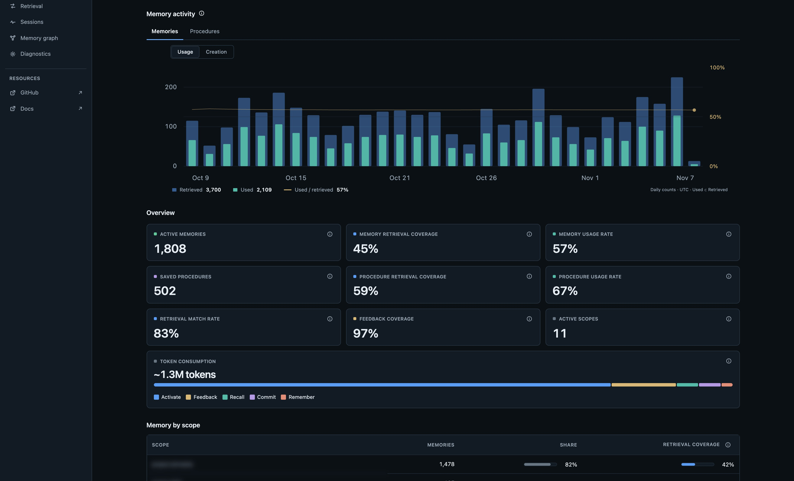</a>
</p>

<p align="center">
    <a href="img/memories.jpg">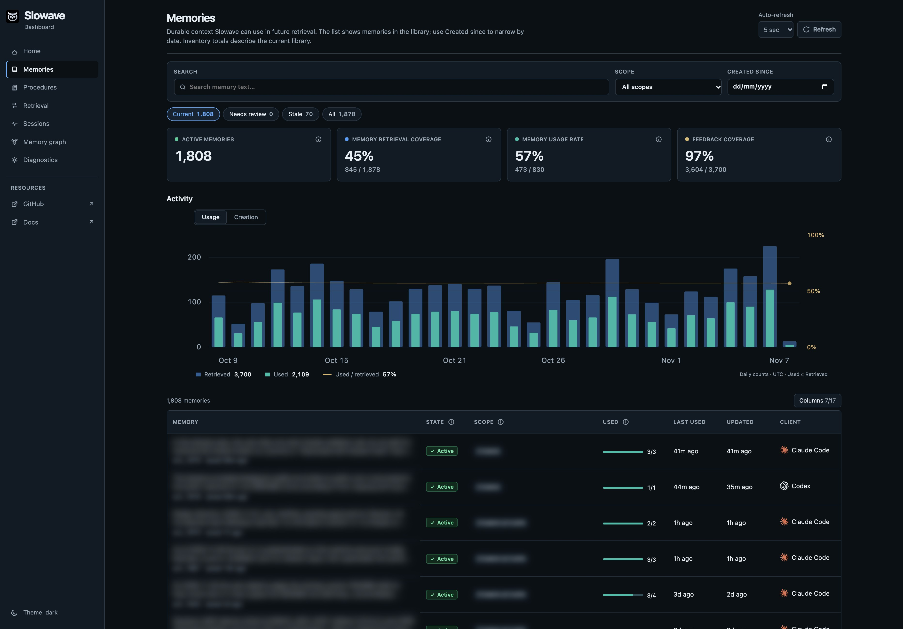</a>
    <a href="img/procedures.jpg">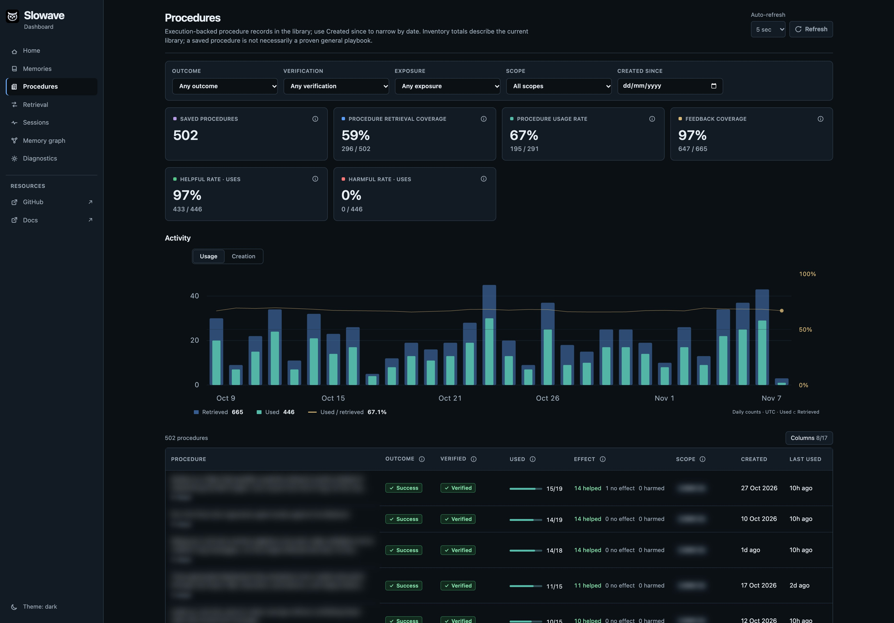</a>
    <a href="img/retrieval.jpg">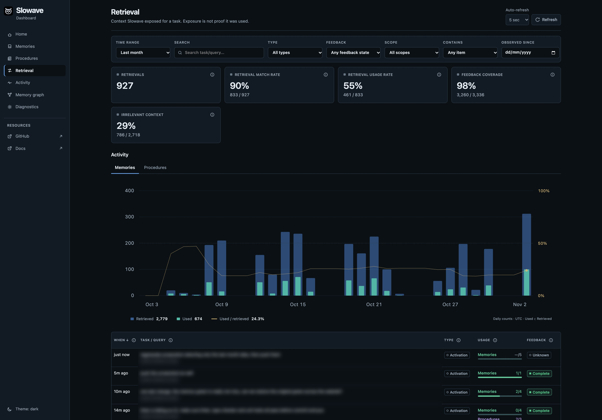</a>
    <a href="img/graph.jpg">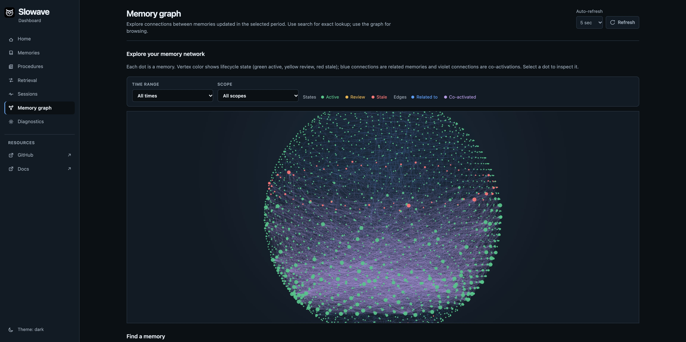</a>
    <a href="img/activity.jpg">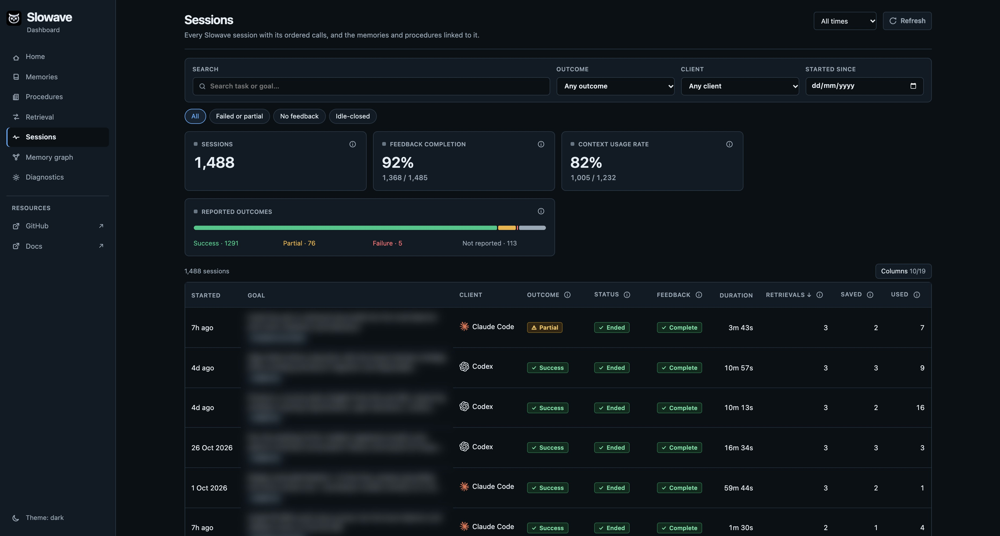</a>
</p>


From the dashboard you can:

- Inspect memories and their lifecycle
- Review learned procedures and their reuse
- Trace retrievals and agent feedback
- Explore session history and activity
- Visualize memory connections and associations
- Monitor system health, maintenance, backups, token consumption


## Supported clients

Client coverage is actively expanding. Suggest more integrations or report broken ones with setup details.

✅ = supported. Copilot validation limits are listed below.

| Client         | macOS | Linux | Windows | Setup                                    |
|----------------|--|--|--|------------------------------------------|
| &nbsp; [Claude Code](integrations/claude-code/README.md) | ✅ | ✅ | ✅ | `slowave setup --client claude-code` |
| <picture><source media="(prefers-color-scheme: dark)" srcset="img/clients/copilot-dark.svg" /></picture>&nbsp; [Copilot CLI](integrations/copilot/README.md) | ✅ | ✅ | ✅ | `slowave setup --client copilot` |
| <picture><source media="(prefers-color-scheme: dark)" srcset="img/clients/openai-dark.svg" /></picture>&nbsp; [Codex](integrations/codex/README.md) | ✅ | ✅ | ✅ | `slowave setup --client codex` |
| &nbsp; [Cursor](integrations/cursor/README.md) | ✅ | ✅ | ✅ | `slowave setup --client cursor` ¹ |
| &nbsp; [OpenCode](integrations/opencode/README.md) | ✅ | ✅ | ✅ | `slowave setup --client opencode` |
| &nbsp; [Windsurf](integrations/windsurf/README.md) | ✅ | ✅ | ✅ | `slowave setup --client windsurf` |
| <picture><source media="(prefers-color-scheme: dark)" srcset="img/clients/cline-dark.svg" /></picture>&nbsp; [Cline](integrations/cline/README.md) | ✅ | ✅ | ✅ | `slowave setup --client cline` |
| &nbsp; [Antigravity](integrations/antigravity/README.md) | ✅ | ✅ | ✅ | `slowave setup --client antigravity` |
| &nbsp; [Claude Desktop](integrations/claude-desktop/README.md) | ✅ | ✅ | ✅ | `slowave setup --client claude-desktop` ¹ |
| All the above |  |  |  | `slowave setup` |

¹ requires one manual paste after setup

Copilot support targets local CLI execution. Automated integration tests pass, and
native configuration discovery is verified on macOS. A user also confirmed memory
reads and writes through Copilot CLI on macOS. Full model-driven lifecycle and native
Windows/Linux qualification remain pending. IDE, desktop, and hosted/cloud
Copilot support is deferred.

> [!IMPORTANT]
> The default embedding model downloads from Hugging Face on first use (~45 MB, cached locally). Subsequent runs work offline.
>
> Memory is stored in plaintext in the current OS user's application-data directory. Slowave does not send it to a hosted memory service. See [runtime data location](docs/install.md#runtime-data-location).


## How Slowave memory works

Slowave works through 5 simple MCP tools:

- `Activate`: start a task and load relevant memory.
- `Remember`: save a fact, decision, preference, or instruction.
- `Recall`: search memory during a task.
- `Feedback`: assess retrieved memories as `used`, `not_used`, `unassessable`, `irrelevant`, `already_known`, or `stale`.
- `Commit`: save the task outcome and any reusable procedure.

A **background worker** consolidates relevant memories and procedures.

### Slowave MCP lifecycle

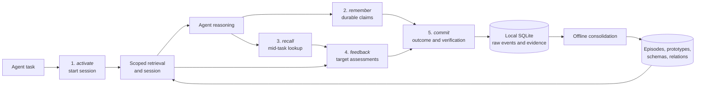

See [architecture.md](docs/architecture.md) and [design.md](docs/design.md) for details.


## Boundaries

- Slowave is a memory layer, not a reasoning engine.
- It cannot recall information that was never recorded.
- Memory quality depends on the client agent and the feedback it provides.
- Slowave adds token overhead from tool calls and retrieved context.
- The local SQLite database is plaintext by default; protect it with OS permissions or full-disk encryption.

> [!IMPORTANT]
> Slowave is public beta software. APIs, configuration, and storage schema may change, and migrations are not guaranteed before stable release.

## Evaluation

The current evaluation notes report preliminary retrieval-evidence results,
methodology, limitations, and commands for running new evaluations. They do not
claim end-to-end agent accuracy or a comparison against other memory systems.
See [benchmarks.md](docs/benchmarks.md) before treating any result as a
production-quality claim.


## Documentation

- [Mintlify documentation](https://slowave-ai.mintlify.app/): full auto-generated documentation
- [design.md](docs/design.md): design rationale, boundaries, and positioning
- [architecture.md](docs/architecture.md): brain-inspired memory model and lifecycle
- [install.md](docs/install.md): installation, setup, lifecycle instructions, modified files, and removal
- [benchmarks.md](docs/benchmarks.md): benchmark results, methodology, and reproduction
- [troubleshooting.md](docs/troubleshooting.md): daemon, worker, dashboard, client integration, database, backup/restore


## Contributing

Slowave is open source under the AGPL-3.0-or-later license.

Contributions are welcome, especially in:

- installation and setup quality
- client integrations
- performance optimization

See [CONTRIBUTING.md](./CONTRIBUTING.md) before submitting a pull request.


## License

Slowave is open source under the [GNU AGPL-3.0-or-later](LICENSE) license.
