---

<p align="center">
  <a href="README.md">English</a> | <b>中文</b>
</p>

<p align="center">
  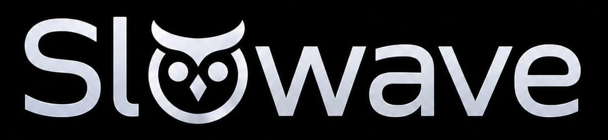
</p>
<p align="center">
  <b>贯通你的编码智能体与 AI 工具的活的记忆层。</b>
</p>
<p align="center">
  <a href="https://pypi.org/project/slowave/"></a>
  
  
  
</p>
<p align="center">
  支持：Claude Code、Copilot CLI、Codex、Cursor、OpenCode、Windsurf/Devin Desktop、Cline、Antigravity、Claude Desktop
</p>


---
Slowave 是一个本地 MCP 记忆服务器，可在你的多次编码会话和各种 AI 工具之间传递你的决策、约束和流程。

Slowave 会在使用中不断自适应，随时间积累可复用的上下文，让你的智能体能够从过往经验中学习。

它运行在你自己的机器上，记忆维护不需要任何 LLM API 密钥。通过本地仪表盘，你可以查看智能体记住了什么，以及它认为哪些记忆有价值。

Slowave 的核心基于一个简单的理念：

> **推理与记忆在持续的循环中相互促进。**

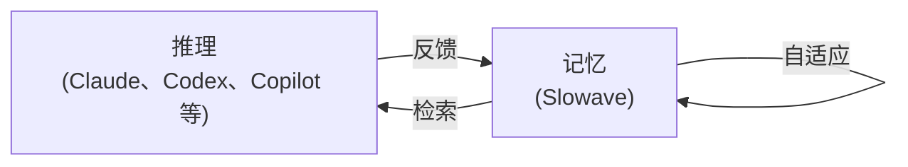

Slowave 会保留有助于智能体达成目标的内容，弱化无益的内容，并根据使用情况持续自适应。它通过你的智能体与其记忆之间的持续反馈循环来实现这一点，仅依赖 5 个简单的 MCP 端点：

> **activate → remember → recall → feedback → commit**


记忆会随着使用不断被重塑，而不是一个静待检索的静态事实集合。

- **跨任务保留上下文：** 你的智能体可以复用已记录的决策、偏好、约束和经验教训。
- **通过反馈演化：** 有用的记忆会变得更强，无关的记忆会降低优先级，过时的知识可以被取代。
- **从经验中学习：** 决策、结果和多步骤的解决方案可以沉淀为智能体可直接据以行动的可复用上下文。
- **本地运行：** Slowave 将记忆存储在 SQLite 中，不会发送到托管的记忆服务。
- **无需 LLM API 密钥：** 记忆核心在执行维护和检索时无需调用 LLM，也不需要 LLM API 密钥。
- **可检查、可度量：** 在本地仪表盘中查看记忆、检索、反馈、流程以及系统性能。

最直接的回报，就是不必在下一个任务中重复同样的约束。

随着时间推移，你的工作方式会变成智能体可复用的上下文。


<p align="center">
  <sub><a href="#支持的客户端">平台覆盖范围与安装详情</a></sub>
</p>

## 安装

### 安装
```bash
pipx install slowave
```

### 设置
```
slowave setup
```

快速开始会配置所有检测到的客户端。如需一次只配置一个客户端，请参阅[安装参考](docs/install.md)。

> [!IMPORTANT]
> **无需 LLM API 密钥。**

### 升级 Slowave

升级到新版本时：

```bash
slowave stop
pipx upgrade slowave
slowave setup
```

如果升级时你正处于某个编码客户端的会话中，可能需要关闭该会话并重新打开（通过 `/resume` 命令或类似方式，取决于客户端）。

## 工作流程

你照常与智能体协作即可。

你可以切换智能体，也可以开启新的会话。

Slowave 会用相关的记忆和流程来丰富智能体的上下文。智能体会向 Slowave 反馈哪些内容有用。Slowave 则在后台持续为你的智能体构建相关的上下文。


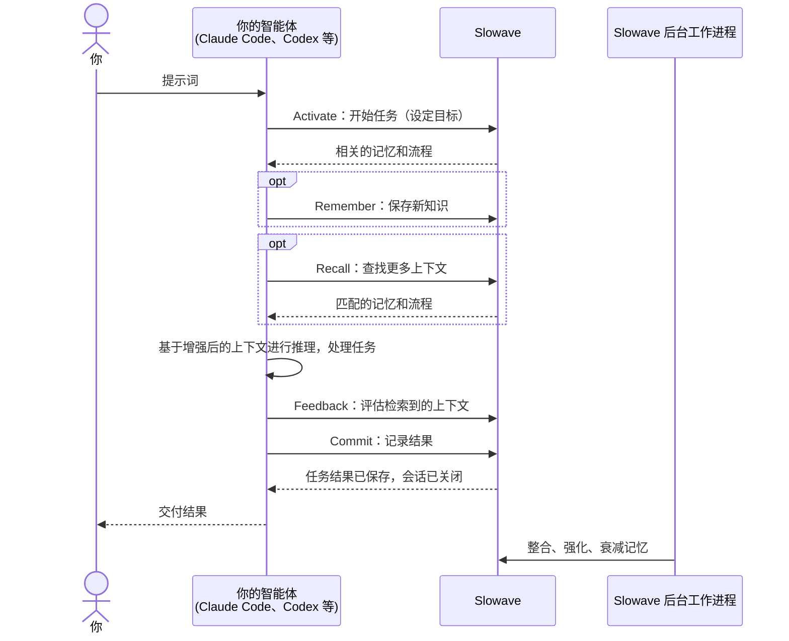


## 仪表盘

本地仪表盘展示 Slowave 随时间推移对智能体记忆的实际处理：它记住了什么、检索了什么，以及你的智能体报告使用了什么。

随着历史记录的增长，你可以追踪一条记忆的来源，直至它后来被检索和使用的任务。你可以查看已学到的流程，了解检索到的上下文何时有用、何时无关，并判断 Slowave 是在帮助智能体复用过往工作，还是仅仅在堆积记忆。

使用以下命令启动仪表盘：

```bash
slowave dashboard
```

在仪表盘中你可以：

- **查看记忆：** 查看保存了什么、来自哪里、当前状态，以及后来何时被检索或使用。
- **查看流程：** 回顾从以往工作中沉淀的可复用方法，并了解它们何时被检索和复用。
- **追踪检索：** 查看请求、Slowave 实际返回的上下文，以及智能体报告的反馈。
- **跟踪活动：** 查看任务、检索、反馈、记忆更新，以及它们之间的关联。
- **探索记忆关联：** 浏览记忆之间的关系和联想。
- **检查系统健康：** 查看数据库、后台维护、备份和本地服务。

概览页还能帮助你判断记忆循环是否在正常运转：现有多少记忆和流程，检索到的上下文被报告为已使用的频率，被标记为无关的比例，反馈是否被记录，以及记忆的创建、检索和使用随时间如何变化。

Slowave 还会显示通过所有 MCP 端点返回的上下文量的粗略估算，方便你留意记忆带来的开销。

<p align="center">
    <a href="img/overview.jpg">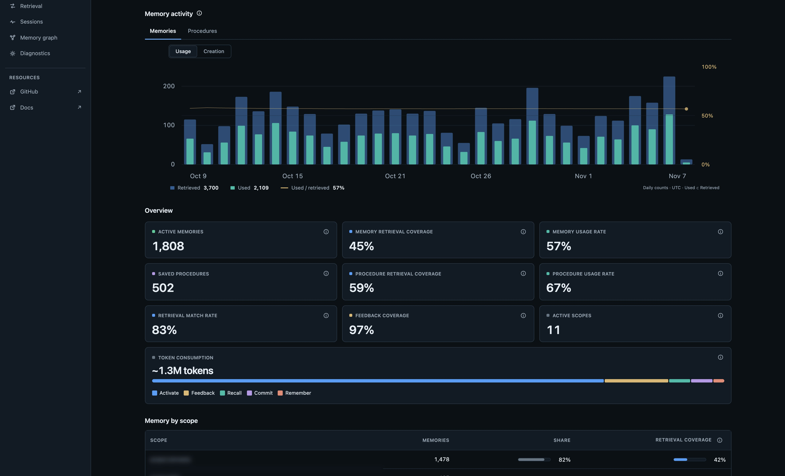</a>
</p>

<p align="center">
    <a href="img/memories.jpg">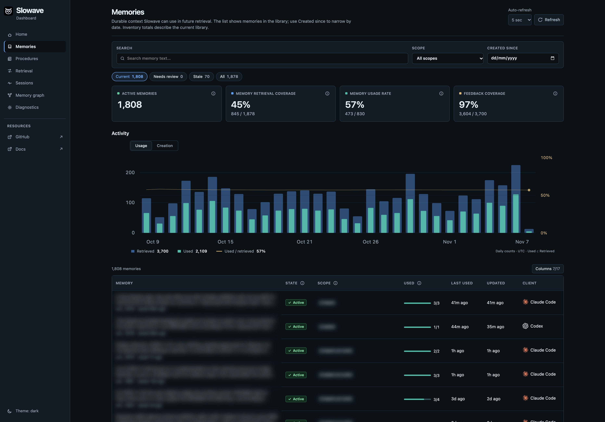</a>
    <a href="img/procedures.jpg">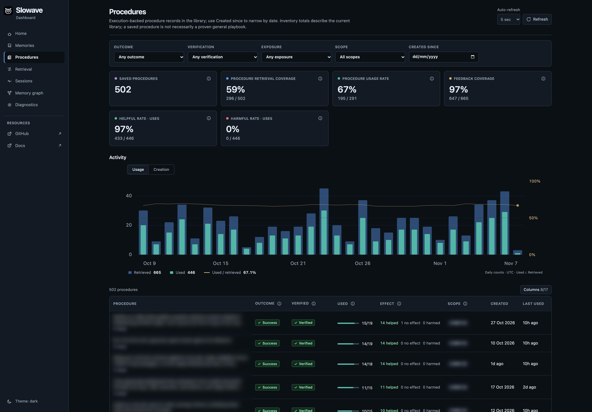</a>
    <a href="img/retrieval.jpg">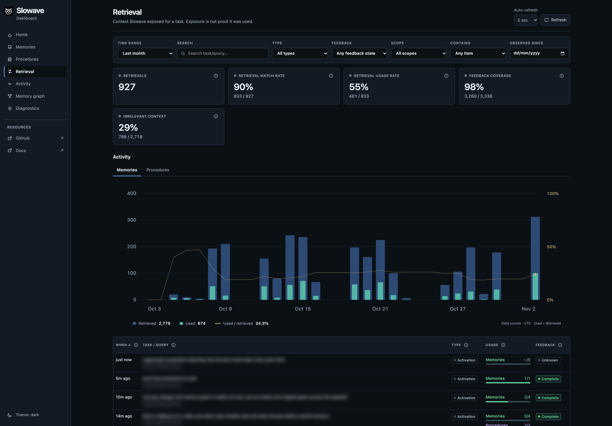</a>
    <a href="img/graph.jpg">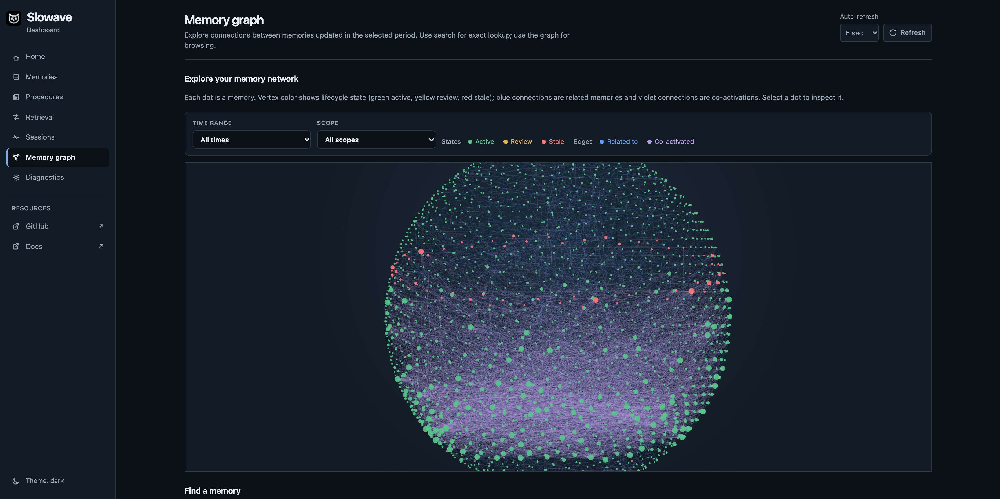</a>
    <a href="img/activity.jpg">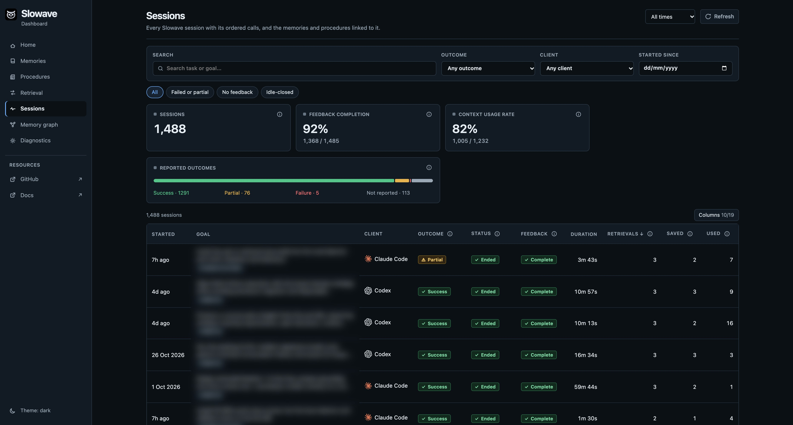</a>
</p>


## 支持的客户端

客户端覆盖范围正在积极扩大。欢迎提议更多集成，或附上安装详情反馈有问题的集成。

✅ = 已支持。Copilot 的验证限制见下文。

| 客户端         | macOS | Linux | Windows | 安装                                    |
|----------------|--|--|--|------------------------------------------|
| &nbsp; [Claude Code](integrations/claude-code/README.md) | ✅ | ✅ | ✅ | `slowave setup --client claude-code` |
| <picture><source media="(prefers-color-scheme: dark)" srcset="img/clients/copilot-dark.svg" /></picture>&nbsp; [Copilot CLI](integrations/copilot/README.md) | ✅ | ✅ | ✅ | `slowave setup --client copilot` |
| <picture><source media="(prefers-color-scheme: dark)" srcset="img/clients/openai-dark.svg" /></picture>&nbsp; [Codex](integrations/codex/README.md) | ✅ | ✅ | ✅ | `slowave setup --client codex` |
| &nbsp; [Cursor](integrations/cursor/README.md) | ✅ | ✅ | ✅ | `slowave setup --client cursor` ¹ |
| &nbsp; [OpenCode](integrations/opencode/README.md) | ✅ | ✅ | ✅ | `slowave setup --client opencode` |
| &nbsp; [Windsurf](integrations/windsurf/README.md) | ✅ | ✅ | ✅ | `slowave setup --client windsurf` |
| <picture><source media="(prefers-color-scheme: dark)" srcset="img/clients/cline-dark.svg" /></picture>&nbsp; [Cline](integrations/cline/README.md) | ✅ | ✅ | ✅ | `slowave setup --client cline` |
| 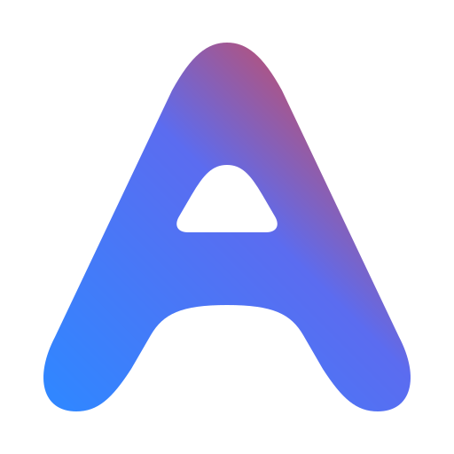&nbsp; [Antigravity](integrations/antigravity/README.md) | ✅ | ✅ | ✅ | `slowave setup --client antigravity` |
| &nbsp; [Claude Desktop](integrations/claude-desktop/README.md) | ✅ | ✅ | ✅ | `slowave setup --client claude-desktop` ¹ |
| 以上全部 |  |  |  | `slowave setup` |

¹ 安装后需要手动粘贴一次

Copilot 支持面向本地 CLI 执行。自动化集成测试已通过，原生配置发现已在 macOS 上验证。
也有用户确认在 macOS 上通过 Copilot CLI 可以读写记忆。完整的模型驱动生命周期验证，
以及原生 Windows/Linux 的资质验证仍待完成。IDE、桌面端以及托管/云端的
Copilot 支持暂缓。

> [!IMPORTANT]
> 默认的嵌入模型会在首次使用时从 Hugging Face 下载（约 45 MB，并在本地缓存）。之后的运行可离线工作。
>
> 记忆以明文形式存储在当前操作系统用户的应用数据目录中。Slowave 不会将其发送到托管的记忆服务。参见[运行时数据位置](docs/install.md#runtime-data-location)。


## Slowave 记忆的工作原理

Slowave 通过 5 个简单的 MCP 工具工作：

- `Activate`：开始任务并加载相关记忆。
- `Remember`：保存事实、决策、偏好或指令。
- `Recall`：在任务过程中搜索记忆。
- `Feedback`：将检索到的记忆评估为 `used`（已使用）、`not_used`（未使用）、`unassessable`（无法评估）、`irrelevant`（无关）、`already_known`（已知）或 `stale`（过时）。
- `Commit`：保存任务结果以及任何可复用的流程。

**后台工作进程**会整合相关的记忆和流程。

### Slowave MCP 生命周期

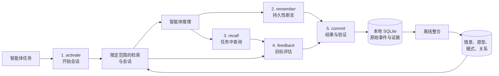

详情请参阅 [architecture.md](docs/architecture.md) 和 [design.md](docs/design.md)。


## 边界

- Slowave 是记忆层，不是推理引擎。
- 它无法回忆从未被记录的信息。
- 记忆质量取决于客户端智能体及其提供的反馈。
- Slowave 会因工具调用和检索到的上下文而增加 token 开销。
- 本地 SQLite 数据库默认为明文；请通过操作系统权限或全盘加密加以保护。

> [!IMPORTANT]
> Slowave 是公开测试版软件。API、配置和存储模式可能会变更，在稳定版发布之前不保证迁移。

## 评估

当前的评估说明报告了初步的检索证据结果、方法、局限性，以及运行新评估的命令。
它们并不声称端到端的智能体准确率，也不包含与其他记忆系统的比较。
在将任何结果视为生产级质量的论断之前，请先参阅 [benchmarks.md](docs/benchmarks.md)。


## 文档

- [Mintlify 文档](https://slowave-ai.mintlify.app/)：完整的自动生成文档
- [design.md](docs/design.md)：设计思路、边界与定位
- [architecture.md](docs/architecture.md)：受大脑启发的记忆模型与生命周期
- [install.md](docs/install.md)：安装、设置、生命周期说明、被修改的文件与移除
- [benchmarks.md](docs/benchmarks.md)：基准测试结果、方法与复现
- [troubleshooting.md](docs/troubleshooting.md)：守护进程、工作进程、仪表盘、客户端集成、数据库、备份/恢复


## 参与贡献

Slowave 以 AGPL-3.0-or-later 许可证开源。

欢迎贡献，尤其是以下方面：

- 安装与设置质量
- 客户端集成
- 性能优化

提交拉取请求之前，请先阅读 [CONTRIBUTING.md](./CONTRIBUTING.md)。


## 许可证

Slowave 以 [GNU AGPL-3.0-or-later](LICENSE) 许可证开源。
